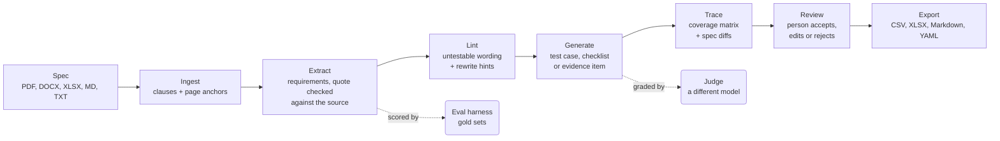

# Spec2Test

**Turns a requirements document into verification items: test cases, inspection checklists and
evidence items, each cited back to the exact sentence it verifies, and scored by an eval
harness.**

[](https://github.com/kruslim/Spec2Test/actions/workflows/ci.yml)


Engineers who verify products against a regulation or a customer spec spend days turning
"shall" statements into test plans by hand. Spec2Test reads the document (PDF, DOCX, XLSX,
Markdown or text), pulls out every requirement, flags the ones that cannot be tested as
written, and writes the right kind of verification item for each one. It never invents a
limit the source does not give: missing values come out as `[bracketed placeholders]`.



## Results

Measured on [FMVSS No. 111](https://www.govinfo.gov/content/pkg/CFR-2025-title49-vol6/pdf/CFR-2025-title49-vol6-sec571-111.pdf)
(US rear-visibility regulation, public domain) against a 39-requirement gold set. The model is
not deterministic (Kimi accepts temperature 1 only), so numbers are ranges over repeated runs.

| What | Result | Run |
| --- | --- | --- |
| Extraction recall | 94.9-100% | 3 live runs, Kimi (`kimi-for-coding`), Oct 31 2026 |
| Extraction precision | 94.9-95.1% | same 3 runs |
| Field accuracy (values, units, conditions) | 64.1-76.9% | same 3 runs |
| Verification method accuracy | 81.1-84.6% | same 3 runs |
| Items judged acceptable unedited | 76.9% of 39 | Claude Opus 5.5 judge, one Kimi generation run |
| Checklist items acceptable, after a prompt fix | 55.6-62.5% → 66.7-88.9% | 3 Kimi runs per arm, blind Opus judge ([#12](https://github.com/kruslim/Spec2Test/pull/12)) |

**Read these with care.** The judge is **uncalibrated**: no person has labeled the 30-item
calibration sample yet, so judge scores are one model's opinion of another's work. The gold
set was labeled by Claude Opus and reviewed line by line by the project owner; its newest
testability flags are not reviewed yet. One document is not a benchmark. How each number is
computed: [docs/DESIGN.md](docs/DESIGN.md#evaluation).

## Example

A real item from the FMVSS 111 run (generated by Kimi, judged acceptable by Opus). The source
sentence:

> S5.4.2 Each convex mirror shall have permanently and indelibly marked at the lower edge of
> the mirror's reflective surface, in letters not less than 4.8 mm nor more than 6.4 mm high
> the words "Objects in Mirror Are Closer Than They Appear."

What the pipeline produced, abridged:

| Stage | Output |
| --- | --- |
| Extract | `fmvss-111:S5.4.2:1`, page 2, section S5.4.2, criterion: letter height between 4.8 and 6.4 mm, method: inspection |
| Lint | `vague_term`: "permanently and indelibly" has no test procedure, so two testers could disagree. Suggested rewrite asks for a `[durability test procedure]`. |
| Generate | **Checklist item.** Inspect: each convex mirror's lower edge; measure letter height with a rule or caliper readable to 0.1 mm. Pass: the exact words are present, every letter is 4.8-6.4 mm high, and the marking survives `[permanence test method and acceptance criterion to be decided]`. |

The placeholder is the point: the regulation does not say how to test "indelibly", so the
item says so instead of making a number up.

## Quick start

Requires [uv](https://docs.astral.sh/uv/); it installs the pinned Python too.

```bash
git clone https://github.com/kruslim/Spec2Test.git && cd Spec2Test
uv sync

# Run the whole pipeline offline on an invented spec: no API key, no cost.
# --fake replays canned model answers from tests/fixtures/llm.
uv run spec2test ingest examples/widget-lamp.txt
uv run spec2test extract examples/widget-lamp.txt --fake tests/fixtures/llm --out extraction.json
uv run spec2test lint extraction.json --fake tests/fixtures/llm --out lint.json
uv run spec2test generate lint.json --doc examples/widget-lamp.txt --fake tests/fixtures/llm --out generation.json
uv run spec2test trace generation.json
uv run spec2test export generation.json --format markdown
```

The extraction step shows the citation check at work: one canned answer paraphrases the source
instead of quoting it, so it is rejected rather than passed on.

Live runs use Kimi (`KIMI_CODE_API_KEY`) or Anthropic (`ANTHROPIC_API_KEY`); drop `--fake`.
The review app runs locally: `uv sync --extra ui`, then `uv run spec2test review open`.

## What it does

| Command | What it does |
| --- | --- |
| `ingest` | Parses a document into numbered clauses with page and character offsets ([Docling](https://github.com/docling-project/docling) for PDF, DOCX, XLSX, Markdown) |
| `extract` | One record per obligation; each quote must appear verbatim in its section or it is rejected |
| `lint` | Rules, then a model pass, flag vague, unit-less, compound or unbounded wording |
| `generate` | Test case, checklist or evidence item by verification method, with the clause's definitions and referenced clauses as context |
| `judge`, `calibrate` | Grade items against a written rubric; measure judge-human and judge-judge agreement |
| `eval`, `dashboard` | Score extraction against a gold set with a failure category for every miss; track runs and their spread |
| `trace`, `diff` | Coverage matrix and gaps; which items to update when the spec changes |
| `review`, `export` | Streamlit review app with a SQLite decision log; export per customer profile |

Full reference for every stage and flag: [docs/USAGE.md](docs/USAGE.md).

## How it is built

- **One canonical record.** Every stage reads and writes a Pydantic `Requirement`; every
  output format is a rendering of it.
- **Provider-agnostic.** Stages depend on an `LLMClient` interface with Kimi, Anthropic,
  OpenAI-compatible, session-answered and fake implementations. Token use and cost are logged
  per call.
- **A model never grades its own work.** Kimi generates; Claude Opus labels gold sets and
  judges; Gemini only cross-checks the judge on a 30-item sample. The CLI refuses a judge that
  is the generator's own model.
- **Tested offline.** 413 tests replay recorded model answers, so CI (Ubuntu and Windows,
  Python 3.12 and 3.13) needs no API key.
- **A data firewall.** Only public or invented documents are in the repo; documents that may
  not be redistributed are pinned by sha256 and stay out of git.

Stack: Python, uv, Pydantic, Docling, httpx, Streamlit, SQLite, openpyxl, pytest, ruff,
GitHub Actions.

The reasoning behind each choice, the trade-offs and an FAQ: [docs/DESIGN.md](docs/DESIGN.md).

## Status

Phases 0-10 of the [build plan](docs/PLAN.md) are done: the full pipeline, eval harness, judge,
traceability, review app, plugins and dashboard. Hosting for outside users (sign-in,
per-workspace data, a monthly cost cap) is built and tested but not deployed; the app runs
locally. Next steps: human labels to calibrate the judge, and gold sets for a second domain.

## Documentation

| Doc | For |
| --- | --- |
| [docs/DESIGN.md](docs/DESIGN.md) | Architecture, model roles, eval and judge design, trade-offs, FAQ |
| [docs/USAGE.md](docs/USAGE.md) | Every stage and its CLI |
| [docs/PLAN.md](docs/PLAN.md) | Build plan and what each phase measured |
| [docs/DEPLOY.md](docs/DEPLOY.md) | Hosting runbook (built, not in use) |
| [gold/README.md](gold/README.md) | Gold-set format and labeling policy |

## Development

```bash
uv sync
uv run ruff check . && uv run ruff format --check .
uv run pytest                              # offline
SPEC2TEST_LIVE=1 uv run pytest -m live     # calls Kimi and Anthropic; costs money
```

Built by [@kruslim](https://github.com/kruslim).
