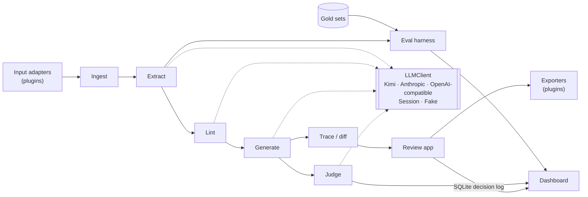

# Spec2Test system design

What Spec2Test is built from, why each choice was made, and what it gives up. For the CLI of
each stage see [USAGE.md](USAGE.md); for the build history and every measured run see
[PLAN.md](PLAN.md).

## Contents

- [Problem](#problem)
- [Architecture](#architecture)
- [The canonical record](#the-canonical-record)
- [Pipeline stages](#pipeline-stages)
- [The LLM layer](#the-llm-layer)
- [Model roles](#model-roles)
- [Evaluation](#evaluation)
- [The judge](#the-judge)
- [Data firewall](#data-firewall)
- [Engineering practices](#engineering-practices)
- [Trade-offs and limitations](#trade-offs-and-limitations)
- [FAQ](#faq)

## Problem

Any regulated product is verified against a stack of documents: regulations, standards,
customer specs. Each "shall" has to become a test, an inspection or a piece of evidence, and an
auditor has to be able to trace every item back to the sentence it verifies. That translation
is slow, done by hand, and easy to get subtly wrong: a missed condition, a tolerance copied
wrong, a limit nobody wrote down.

A language model can draft most of it, but a draft is only useful if three things hold:

1. **Every item is traceable.** It cites the exact source text, and that citation is checked,
   not trusted.
2. **Nothing is invented.** A value the source does not give is left visibly open, never filled
   in with a plausible number.
3. **Quality is measured.** Accuracy is reported against labeled data, per run, with its
   run-to-run spread, so a prompt change can be shown to help or not.

Those three requirements drive most of the design below.

## Architecture

- **A pipeline of independent stages.** Each stage is a Python package
  (`src/spec2test/<stage>/`) with `models.py` (Pydantic input and output), `prompts.py` and
  `pipeline.py`, plus a CLI subcommand. Each stage reads and writes JSON, so any stage can run
  alone on a saved output from the stage before. That makes runs cheap to repeat: a saved
  extraction can be rescored, linted again or judged again without new model calls.
- **Adapters at both edges, a fixed core in the middle.** Input formats and export formats are
  plugins found by Python entry point. A new customer format is a new package, not a change to
  the core.
- **Shared services underneath.** The LLM interface, token and cost accounting, and the eval
  harness are used by every stage.

## The canonical record

Every stage works on one record, `spec2test.schema.Requirement`:

| Field | Holds |
| --- | --- |
| `id` | `<doc>:<section>:<n>`, deterministic |
| `source_anchor` | document, page, section, start and end offsets, exact quote |
| `text` | the requirement, one obligation |
| `type`, `strength` | functional, performance, safety, interface, regulatory; shall, should, may |
| `criteria` | parameter, comparator, value, upper value, unit, tolerance |
| `conditions` | applicability, exceptions, state, the test procedure the clause names |
| `verification_method` | inspection, test, demonstration, analysis |
| `testability_flags` | kind, reason, suggested rewrite |

Verification items (`VerificationItem`) are renderings of this record, and their kind follows
from the method: inspection gives a checklist item, test gives a test case, demonstration and
analysis give evidence items.

**Why one record:** it is what makes the system document-agnostic. A regulation, a NASA
standard and a race rulebook are drafted differently, but once each is reduced to the same
record, everything downstream (lint, generate, trace, export, the eval) is shared. The four
verification methods are the standard systems-engineering ones, so the output maps onto how
verification teams already plan work.

## Pipeline stages

**Ingest.** Docling parses PDF, DOCX, XLSX and Markdown into reading-order blocks with page
numbers; a plain-text adapter handles `.txt`. The core then finds numbered clauses (`S5.5.1`,
`5.1.1.`, `T.1.2`, `Annex 3`), builds one section per clause with its parent and page, and
drops running heads repeated on three or more pages. Every offset points into one canonical
text, so later stages can check a quote character for character. Docling runs locally, so
ingestion makes no model call and sends no document anywhere.

**Extract.** Only sections with normative wording (shall, must, should, may, ...) go to the
model, one section per call. The model returns records with a quote; the pipeline, not the
model, finds the quote in the section and fills in offsets, page and section. A quote that is
not there verbatim goes back to the model once with the error, and then is rejected, never
passed on. Compound requirements split one obligation per record. The prompt follows the same
labeling policy as the gold sets, so the eval measures the model, not a policy mismatch.

**Lint.** Deterministic rules run first: vague words ("adequate", "sharp"), escape clauses ("as
appropriate"), "etc.", "and/or", unbounded wording ("minimise", "never"), numbers without
units, tested levels without test conditions, more than one "shall". A model pass then sees each
section's records with the rule flags and adds only what the rules missed. Every model flag
must quote words from its own requirement or it is rejected. Each flag carries a rewrite with
the missing parts in [brackets].

**Generate.** One item per requirement, by its method. The model sees the requirement and its
source context: the headings around it, its whole section, the definitions of the terms it
uses, and the clauses it references with their subclauses (up to 12 clauses and 40,000
characters). Each item is checked: its pass verdict must state every criterion value of the
requirement, and a demonstration needs a procedure. A failing item gets one retry with the
errors, then is rejected. Permissions and clauses that only define a measurement are skipped
with a reason, not sent.

**Trace and diff.** The traceability matrix lists each requirement with the items that verify
it, and why one has none (skipped, unclassified, rejected, failed, missing). `diff` compares two
extractions of two spec revisions: records pair by source quote similarity (not by id, since an
inserted clause shifts every id after it), and each change says what to do with the old items:
write, retire, update, review or relink.

**Review.** A local Streamlit app shows each item next to its source section with the quote
highlighted; a person accepts, edits or rejects it. Decisions are appended to SQLite, never
overwritten, so an item's history stays. The share of items accepted unedited is the production
metric.

**Export.** A TOML profile per customer sets the ID scheme, columns, vocabulary and required
fields; exporters write CSV, XLSX, a Markdown checklist or YAML. A required field with no value
is written as `[Label]` and reported. CSV and XLSX cells are defused so a generated item cannot
run as a spreadsheet formula.

**Deploy (built, not in use).** A hosted mode adds OpenID Connect sign-in, one data folder per
workspace, a delete-my-data action, a monthly cost cap enforced on every model call, and a
plain-language data-handling page. It is tested offline but not deployed; the app runs locally.

## The LLM layer

Every stage depends on one abstract class, `spec2test.llm.LLMClient`, whose one method takes a
prompt and a Pydantic schema and returns a validated instance or raises. Implementations:

| Client | Used for |
| --- | --- |
| `OpenAICompatLLM` | Kimi (the default) and Gemini, through OpenAI-compatible endpoints |
| `AnthropicLLM` | Claude through the Anthropic API |
| `SessionLLM` | Answers written by Claude in a Claude Code session, through files (below) |
| `FakeLLM` | Offline tests: replays fixtures matched by schema and prompt substrings |
| `CappedLLM` | Wraps any client; refuses calls past a monthly dollar or token cap |

Design points:

- **Structured output by validation, not trust.** The JSON Schema goes in the prompt, the reply
  is parsed with Pydantic, and a malformed reply fails only its own section or item.
- **Retries only where they are safe.** Rate limits, 5xx errors and refused connections retry
  up to three times (2, 4, 8 s). A timeout does not retry, since the call may already be billed.
- **Cost is recorded, never guessed.** Every call's tokens are kept with the stage's output, and
  cost per run and per page comes from a dated price table. A model without a published price
  (Kimi's coding plan is a subscription) is reported as unpriced with its token counts.
- **`SessionLLM` turns a chat session into a provider.** On the first pass it writes every
  prompt it has no answer for to a `.requests.jsonl` file and exits. Claude, in a Claude Code
  session, answers each one into an answers file. The second pass reads the answers. The key
  is a hash of the whole prompt, so an old answer can never answer a changed prompt, and a reply
  that fails the schema is asked for again with its validation error.

## Model roles

**Rule: a model never grades its own work.** If the model that writes the answer key also takes
the test, its blind spots are counted as correct.

| Role | Model | Why |
| --- | --- | --- |
| Generator: extract, lint, generate | Kimi (`kimi-for-coding`) | The model being scored. Cheap at volume (subscription). |
| Gold-set labeler | Claude Opus, in Claude Code sessions | A stronger model from another family; labels from the source text, never from a pipeline run. |
| Judge | Claude Opus, in Claude Code sessions | Same reasoning; via `SessionLLM` it costs no API tokens, so any saved run can be judged again for free. |
| Judge cross-check | Gemini (`gemini-3.1-pro-preview`) | Paid per token, so it judges only the 30-item calibration sample. |
| Reviewer | The project owner | Reviews every gold line, settles disagreements, labels the calibration sample. |

The code enforces this: the judge refuses the generator's own model and warns about one from the
same family; the eval warns when the scored model shares a family with the gold set's labeler,
or when no person has reviewed the gold set.

Opus both labels requirements and judges items. Those are different tasks, so it never grades
its own output, but its blind spots could show up in both. Three checks cover that: a person
reviews every gold line, Gemini judges the calibration sample so every Opus-Gemini disagreement
is visible, and judge scores are marked uncalibrated until judge-human agreement is measured.

## Evaluation

**Gold sets.** One JSONL file per document, one labeled `Requirement` per line, with a TOML file
that states the labeled scope, the labeler and whether a person reviewed it. The FMVSS 111 set
has 39 requirements (sections S5, S10, S11), labeled by Claude Opus 5.5 and reviewed line by
line by the project owner. Planned sets: one UNECE regulation, one NASA standard (proves the
non-automotive claim) and the Formula SAE rules. Source documents are pinned by sha256 in
`corpora/manifest.toml`.

**Alignment.** Extracted and gold records align by quote overlap: a pair must share at least
half of the shorter quote, and each record aligns at most once. Ids are not used, because two
extractions number records differently.

**Metrics.**

| Metric | Right when |
| --- | --- |
| Recall / precision | a gold / extracted record has an aligned partner |
| Field accuracy | criteria (comparator, value, unit, tolerance) and conditions both right |
| Type, strength, method accuracy | equal on aligned pairs |
| Flag precision / recall | same flag kinds raised on aligned pairs |

Units compare by meaning (`s` equals `seconds`); conditions by text similarity of at least 0.8.
Flags are scored on aligned pairs only, so the linter is measured apart from extraction recall.

**Failure taxonomy.** Every miss gets a category: why a gold record was missed
(`section_failed`, `merged`, `span_mismatch`, `citation_rejected`, ...), why an extra one exists
(`over_split`, `not_in_gold`), or which field of an aligned pair is wrong (`wrong_type`,
`criterion_unit`, `condition_missing`, ...). The HTML report counts them and lists each with
its quote. This is what turns a score into a to-do list.

**Variance.** `kimi-for-coding` rejects every temperature but 1, so runs are not repeatable.
Numbers are quoted as the range over repeated runs on the same code, and the dashboard groups
runs by corpus, model and code version (package version plus git commit) to show that spread. A
change that lands inside the spread has not been shown to help.

**Free re-measurement.** A saved run can be rescored without model calls
(`eval --rescore`), so fixing a gold label or a lint rule costs nothing to measure.

**Measured (FMVSS 111, Phase 10, Oct 31 2026; three live Kimi `kimi-for-coding` evals):**
recall 94.9-100%, precision 94.9-95.1%, field accuracy 64.1-76.9%, type accuracy 84.6-87.2%,
method accuracy 81.1-84.6%, flag precision 56.2-69.2%, flag recall 81.8-90.9%. The 94.9% recall
run had one failed extraction call, so its recall is understated. The four Kimi runs used
406,395 tokens; Kimi's plan is a subscription, so no dollar cost is recorded.

## The judge

**Rubric.** Five pass/fail criteria plus one overall call:

| Criterion | Passes when |
| --- | --- |
| `covers` | every obligation, criterion and condition is verified, and no pass/fail condition is added |
| `faithful` | values, units, tolerances, conditions and stated procedures match the source; no limit invented |
| `objective_verdict` | two competent testers would reach the same verdict |
| `executable` | a technician could carry it out without guessing |
| `method_fit` | it verifies the way its method says (measure, look, operate, calculate) |
| `acceptable` | an engineer would put it in the verification plan unedited |

**Why binary.** A person can label pass/fail consistently; a 1-10 scale they cannot. Binary
labels also make agreement measurable with Cohen's kappa.

**Calibration.** `calibrate sample` draws 30 items across item kinds and stores each with its
requirement and source context, so the person and the judge see the same thing. `calibrate
score` reports judge-human agreement and kappa per criterion. The human labels must come from a
person: a labeler named like a model ID gets a warning, and the sample file refuses to be
overwritten once it holds labels. Every judgement stores a hash of what it graded, so a
regenerated item is never scored against an old grade.

**Measured, and uncalibrated.**

- Phase 10 (Oct 31 2026): Claude Opus 5.5, in a session, judged all 39 items Kimi generated from
  one extraction run: 76.9% acceptable unedited (test cases 77.8%, evidence 83.3%, checklists
  66.7%), 92.3% of rubric criteria passed.
- Opus vs Gemini (`gemini-3.1-pro-preview`) on the 30-item sample: 73.3% agreement on
  `acceptable`, kappa 0.43. This says where the judges differ; it does not calibrate either.
- Earlier (Phase 5, Gemini judge, older rubric wording): adding source context (headings, the
  whole section, definitions, referenced clauses) raised acceptability from 29.7% to 64.9% on the
  same 37 requirements. Not comparable with the Opus numbers: different judge, run and rubric.
- Checklist prompt fix (PR #12): on the 10 inspection requirements, 3 Kimi runs per arm, judged
  blind by Opus with the before and after items pooled, checklist items acceptable went from
  55.6-62.5% to 66.7-88.9%.

None of these is calibrated: the 30 human labels do not exist yet, so judge scores are one
model's opinion of another's work.

## Data firewall

The repo is public, so what goes in it is restricted by rule, not by habit:

- Only public-domain regulations, standards excerpts that are free to redistribute, and
  documents written for the project. No employer or customer material of any kind, not even as
  a test fixture.
- Every fixture and gold line must be traceable to a public source in the manifest, or be
  visibly invented (the `widget_lamp` spec used throughout the tests).
- Documents that may be read but not redistributed (the UNECE regulation, the Formula SAE
  rules) are pinned by sha256 and git-ignored, together with their gold sets and judge samples,
  since a gold line quotes its source.
- Review logs store the whole source document, so SQLite files are git-ignored.
- A `/firewall-check` step runs before every commit; API keys come only from the environment.

The same idea shapes the architecture: everything specific to one organization lives in
adapters, profiles and configs outside the core, so the core never needs to see private data.

## Engineering practices

- **Offline by default.** 413 tests run against `FakeLLM` fixtures; a new model call needs a
  fixture. Live tests need both `SPEC2TEST_LIVE=1` and `-m live`, so a variable left in the
  shell never spends money.
- **CI** on Ubuntu and Windows, Python 3.12 and 3.13: ruff lint, ruff format, pytest. Paths use
  `pathlib`; every JSON command has `--out` because PowerShell redirects re-encode text.
- **Built in phases.** Eleven phases (0-10), each with a "done when" line, each landed as a
  reviewed PR with its measured numbers in [PLAN.md](PLAN.md).
- **Measurement before polish.** The eval harness was built in Phase 3, before generation.

## Trade-offs and limitations

| Choice | Gain | Cost |
| --- | --- | --- |
| One section per extraction call | Small prompts, a failure loses one section, the quote check is local | A requirement split across sections is seen in pieces |
| Pipeline finds the quote, not the model | Offsets are always right; hallucinated citations are rejected | Paraphrased but correct requirements are lost (shown as `citation_rejected`) |
| Rules before the model in lint | Cheap, deterministic, explainable flags | Word lists miss subtle ambiguity and over-flag some words; the model pass only adds flags |
| One retry, then reject | Bounded cost per item; failures are visible | Some fixable items are dropped |
| Judge in a chat session | No API spend; any saved run is re-judged for free | Not automated in CI; needs a person to start the session |
| Kimi at temperature 1 | Low cost | Run-to-run noise; every claim needs repeated runs |
| Docling, born-digital PDFs only | Local, free, good layout and tables | No OCR for scanned documents; ~500 MB of models on first run |
| Streamlit and SQLite | Fast to build, one process, no server | Not built for many users at once |

Known limitations:

- One document is scored; a second domain is planned, not done.
- The judge is uncalibrated, and the gold set's newest flags are not reviewed yet.
- No real user has reviewed items yet, so there is no measured acceptance rate from people.
- The hosted mode is built but not deployed.

## FAQ

**Why not just ask one big model to write the test plan?**
Because nobody can check the result. Splitting the work into stages gives each one a checkable
output: quotes are verified against the source, items are checked for their criterion values,
and each stage is scored on its own. When something is wrong, the failure taxonomy says which
stage and why.

**How do you stop the model from making up limits?**
Three ways. The prompt says values the source does not give go in [brackets]. The pipeline
checks that every criterion value of the requirement appears in the item's verdict. The judge's
`faithful` criterion fails any invented limit. The example in the README, an "indelible" marking
with no test method in the regulation, is that rule working.

**How is a hallucinated citation caught?**
The model never states offsets. It states a quote, and the pipeline searches for it in the
section. If it is not there verbatim (whitespace aside), the model gets one retry with the
error, then the record is rejected and counted.

**Why Kimi as the generator?**
It is the model being scored, and it is cheap at volume on a subscription plan. The design does
not depend on it: a provider is one `--provider` flag, and the eval would score any other model
the same way.

**Why is Opus the labeler and the judge? Isn't that a conflict?**
It never grades its own work: Opus generates nothing that is scored. The remaining risk is
shared blind spots between its labels and its judging, which is why a person reviews every gold
line, Gemini cross-checks the judge, and judge scores stay marked uncalibrated until a person's
labels exist.

**What does "uncalibrated" mean here?**
The judge's agreement with a person has not been measured. Until then, "76.9% acceptable" means
"Opus thought so", not "an engineer would". The tooling to measure it is built; the 30 human
labels are the missing piece.

**Why ranges instead of single numbers?**
The generator only runs at temperature 1, so the same input gives different output. A single
run can be lucky. Ranges over at least three runs on the same code show the noise, and a change
inside that range is not called an improvement.

**How would you add a new document type or customer format?**
Write an input adapter (a class that returns text blocks with page numbers) or an exporter, and
register it by entry point in its own package. Nothing in the core changes. A customer's ID
scheme, columns and vocabulary go in a TOML profile.

**What happens when the spec is revised?**
`spec2test diff` pairs requirements across the two versions by source quote and says, for each
change, which existing items to write, retire, update, review or relink.

**How much does a run cost?**
Every call's tokens are recorded and priced from a dated table. The Phase 10 FMVSS 111 work used
406,395 Kimi tokens over four runs; Kimi is billed by subscription, so no dollar figure is
recorded. Judging in a Claude Code session uses no API tokens. The Gemini cross-check of 30
items is the only per-token spend.

**Why Docling?**
It runs locally (no document leaves the machine at ingestion), handles PDF, DOCX and XLSX in one
library, and keeps page numbers and table structure, which citations need.

**How is it tested without paying for API calls?**
`FakeLLM` replays recorded answers matched by schema and prompt text, so all 413 offline tests
exercise the real prompts, parsing, retries and checks. Live tests are opt-in.

**What would you build next?**
Human labels to calibrate the judge; a second-domain gold set (the NASA standard) to test the
any-industry claim; and real reviewers, whose accept-unedited rate is the metric that matters.
