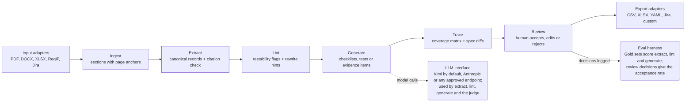

# Spec2Test — Build Plan

Oct 20, 2026 · @Kenneth · updated Oct 21, 2026 (model roles, eval)

## What it is

Spec2Test (working name) turns a requirements document into verification items. It produces both checklists and test cases: the requirement itself decides which one it gets.

Every spec, from any industry, is reduced to the same record first. Outputs are just different renderings of that record. That shared middle layer is what makes "any spec, any industry" possible.

1. **Extract** each requirement (the "shall" statement) with a link back to its page and section.
2. **Classify** how it gets verified, using the standard systems-engineering methods: Inspection, Test, Analysis, Demonstration.
3. **Render** the right output for that method.

| Verification method | Output | Example requirement (illustrative) |
| --- | --- | --- |
| Inspection | Checklist item: what to look at, pass condition | High-voltage enclosure shall carry a warning label |
| Test | Test case: preconditions, setup, steps, expected result, pass/fail criterion, equipment | Rear image shall display within 2.0 s of selecting reverse |
| Demonstration | Procedure + evidence to capture | Driver shall exit the vehicle unassisted within a set time |
| Analysis | Evidence item: calculation or report to attach | Structure shall withstand a specified load |

**The canonical requirement record** holds: ID, source anchor (doc, page, section, exact span), text, type (functional, performance, safety, interface, regulatory), strength (shall / should / may), measurable criteria (parameter, value, unit, tolerance), conditions, verification method, and testability flags.

**Scope for v1:** prove it on two domains with measured accuracy, not "any industry" on day one. The schema is industry-agnostic; the claim that it works is earned one eval set at a time.

## Architecture

Eight stages run in one pipeline, with adapters at both ends and two shared services underneath.

*Spec2Test pipeline · 8 stages, 2 shared services. Every spec becomes one canonical record, then any output format.*



Adapters at both ends are where each customer's formats live; the core in between never changes. That boundary is the FDE work, and it is what lets Ford plug in later without anything crossing the line.

## Model roles

The pipeline only ever talks to `LLMClient`, so models are a configuration choice. One rule fixes the roles: **a model never grades its own work.** If the model that writes the answer key also takes the test, its blind spots count as correct and the scores overstate accuracy.

| Role | Model | Notes |
| --- | --- | --- |
| Pipeline: extract, lint, generate | Kimi (`kimi-code`, OpenAI-compatible endpoint) | Always the generator: the model whose output is scored. The default `--provider`; Anthropic (`--provider anthropic`) and any approved endpoint stay pluggable. |
| Gold-set labeler | Claude Opus, in Claude Code sessions | Labels from the source text directly, never from a pipeline run. No API key: sessions cost no API tokens. |
| Test-case judge | Claude Opus, in Claude Code sessions | Judges saved Kimi generations through `--provider session` (`spec2test.llm.SessionLLM`), so judging costs no API tokens and any saved run can be judged again for free. |
| Independent check | Gemini (`gemini-3.1-pro-preview`), paid | Judges only the 30-item calibration sample, once per rubric or generator change, never a full run; `spec2test calibrate compare` reports its agreement with Opus on those items. |
| Second labeler | None (decided Oct 31, 2026) | You review every gold line instead, so no label-agreement number is reported. |
| Reviewer | You | Settles every disagreement, signs off a gold set before its numbers are quoted, and labels the calibration sample: the judge counts only once its agreement with you is reported. |

**Model roles revised (Oct 31, 2026): Kimi generates, Opus labels and judges, Gemini only checks.** Kimi always generates. Claude Opus is the stronger model and costs nothing in Claude Code sessions, but has no API, so it does the work that can be done over saved files: labeling gold sets and judging saved generations. Gemini costs API tokens, so it is kept only as a small independent check on the judge. This replaces the Oct 30 decision that made Gemini the judge of every run and the planned second labeler. It keeps the rule that a model never grades its own work:

- Opus judges Kimi's items, never items it wrote: Opus generates nothing, and the judge refuses the generator's own model and warns about its family. Kimi, the only model being scored, labels and judges nothing.
- Opus labels requirements and judges items, two different things, so it never grades its own labels. The narrower risk is that its blind spots show up in both. Three checks cover it: you review every gold line, Gemini judges the calibration sample so every Opus-Gemini disagreement on it goes to you, and the judge's numbers count only once its agreement with your labels (`spec2test calibrate score`) is reported.
- Opus numbers are marked as session runs, with the model ID that served the session, not as API runs.
- Gemini spend drops from one call per generated item on every judged run (37 on FMVSS 111) to one call per sample item (30) per rubric or generator change, and to none for the label-agreement metric.

The eval enforces this: each gold set records its `labeler` and whether a person has `reviewed` it, and every eval run warns when the scored model is from the labeler's family or the gold set is unreviewed. No vision model is involved: Docling reads PDFs with its own local layout models.

## Eval plan

The eval harness is built in phase 3, before generation is polished. Building measurement first is the story that separates you from other candidates, and it is what lets you claim cross-industry accuracy honestly.

**Gold sets** (public sources only; labeled by Claude Opus in sessions, a model other than the pipeline's, see Model roles, then reviewed by you). Each is `gold/<corpus>.jsonl` plus a `.toml` that states the labeled scope, the labeler and whether it has been reviewed (format: `gold/README.md`):

| Corpus | Why it is in the set | Size target |
| --- | --- | --- |
| FMVSS 111 (US federal, public domain) | Measurable timing and field-of-view requirements; you know it cold | \~40 requirements |
| One UNECE regulation | Different drafting style, international | \~40 requirements |
| One FSAE rules chapter | Inspection-heavy; matches your first design partners. Keep out of the public repo | \~60 requirements |
| One public NASA standard | Proves the non-automotive claim | \~40 requirements |

**Metrics:**

| Metric | What it measures |
| --- | --- |
| Extraction recall / precision | Requirements found vs. the gold list |
| Field accuracy | Values, units, tolerances and conditions right: values and comparators exactly, units by meaning (`s` = `seconds`), conditions by close text match |
| Method accuracy | Verification method matches the gold label |
| Testability flags | Vague, compound or unit-less requirements caught (precision / recall) |
| Test-case quality | Rubric-based judge (Claude Opus in sessions, a different model from the Kimi generator), calibrated against your own labels; report judge-human agreement, and Opus-Gemini agreement on the calibration sample |
| Label agreement | Only if a second labeler is run (optional, paid): how often the two labelers agree before your review |
| Acceptance rate | Share of items design partners accept unedited (the production metric) |
| Cost and latency | Dollars and seconds per page. Every `LLMClient` records each call's tokens; `eval`, `generate` and `judge` report dollars per run and per page from the price table in `spec2test/llm/usage.py` (Kimi Code is unpriced: it is billed by subscription) |

Two test layers: deterministic fake-LLM tests on every commit, and a live eval run on every prompt or model change. Reuse the failure-taxonomy approach from Canopy so every miss gets a category, not just a score. A saved run can be rescored without model calls (`spec2test eval <corpus> --rescore results.json`), so fixing a label costs nothing.

## Audit decisions (Oct 31, 2026)

The audit of Phases 0-8 (report: https://claude.ai/artifact/6dPB5SHHwDYkbo7cyepYHu, findings 1-24) is closed. Findings 1-5 and 16 were fixed in PR #3 and PR #6; the rest in the audit-fix change. You approved paid runs for this work; the runs below are Kimi Code (subscription, so no dollar cost is recorded; tokens are in each `results.json`).

- **Run-to-run variance (8).** No temperature is sent, on purpose: `kimi-for-coding` refuses every temperature but 1 (measured: `"invalid temperature: only 1 is allowed for this model"` for 0 and 0.6), and Google advises keeping Gemini 3 at its default. So variance is measured instead of removed: an eval number is quoted as the range over repeated runs, or called "a single run". Three live Kimi runs of FMVSS 111 on the same code (Oct 31, `eval-reports/fmvss-111/variance-1..3`, not committed): recall 97.4-100%, precision 92.9-97.5%, field accuracy 71.8-74.4%, type accuracy 82.1-86.8%, method accuracy 81.6-87.2%, flag precision 42.1-61.5%, flag recall 72.7% in all three. One of the three had one failed extraction call, and its warning said so.
- **Type accuracy (89.2% to 79.5% after the prompt fix).** Mostly noise plus a wider denominator: the earlier 89.2% was 33/37 aligned pairs, the 79.5% was 31/39 (recall rose to 100%), and the three runs above give 82.1-86.8% on the same code. What is systematic is the type rule: in every run, 2-3 misses are Kimi calling FMVSS 111 mirror requirements `safety` (the whole standard serves safety), and 2-3 are `performance` requirements that only point at another clause's levels called `functional`. A sharper type rule was tried (safety only for harm from the item itself; requiring another clause's measurable levels is performance) and measured over three more live Kimi runs (`type-prompt-1..3`): type accuracy 84.6-87.2%, no better than the 82.1-86.8% spread, with the misses moved from `safety` to `performance`; field accuracy was 61.1-66.7% in those runs. That is inside the field-accuracy noise (the prompt-fix run, with the current prompt, measured 61.5%), but it is no gain, so the change was reverted: the type rule stays as it is, and type accuracy is quoted as a range. With every run counted, the current prompt's field accuracy spans 61.5-74.4% over four runs.
- **Flag scoring (10).** Flags stay scored on aligned pairs only, so flag precision and recall measure the linter apart from extraction recall; a warning now counts the gold flags on missed requirements, which go unscored.
- **Cost per page (11).** Two bases, both kept and labeled: the eval divides by the pages in the gold set's scope ("scope pages"), the other commands by the pages their requirements cite ("cited pages"). They do not add up.
- **Saving JSON on Windows (7).** Every `--json` command takes `--out FILE` (UTF-8), printed JSON escapes non-ASCII characters, and every loader accepts a byte order mark and UTF-16. The README and the session-judge skill use `--out`.
- **Live tests (6, 15).** No live test calls Gemini. Live tests run only with `-m live` as well as `SPEC2TEST_LIVE=1`, and Claude Code asks before any `pytest` command that names `live`.
- **Calibration data (17, 18, 20).** `calibrate sample` refuses to overwrite a file that holds human labels without `--force`. Each judgement stores a hash of the requirement and item it graded, so a regenerated item under the same id is not scored against an old judgement or label. A labeler named like a model ID gets a warning.
- **Referenced clauses (19).** Only clause-like tokens count as references, a bare number only after "paragraph", "clause" and the like, and annex clauses resolve inside their annex. FMVSS 111's references are unchanged (all 39 gold requirements checked).
- **Exports (21-24).** CSV defusing exempts only a signed number with plain unit words, so the DDE payload shape is defused. With a review log, a profile that does not list its statuses exports accepted and edited items only. `export --out` needs `--force` to replace a file.
- **Smaller fixes.** EvalRun records the Docling version and a hash of the document text, and a rescore warns when the text changed (9). `extract --json` and `lint --json` save token usage (12). A session answer that fails the schema is asked for again with its validation error (13). SQLite journal files are ignored and the review app's paid-run tick clears after each run (14).

## Phased build

Ten phases, roughly 6–8 weeks at evening pace (estimate). Run each phase as one Claude Code session, review the diff, make sure tests pass, then commit. Each commit is your rollback point.

**Stack:** Python + uv, Pydantic for the schema, Docling for PDF/DOCX/XLSX parsing, a provider-agnostic LLM interface (Kimi by default, Anthropic and any OpenAI-compatible endpoint, plus a fake model for offline tests), SQLite to start, Streamlit for the v1 review UI.

### Phase 0 — Scaffold

Done when: repo installs with one command, CI runs, the fake LLM returns canned structured output.

```text
Create a Python project "spec2test" managed with uv. Add: Pydantic models for Requirement (id, source_anchor{doc, page, section, start, end, quote}, text, type, strength, criteria[{parameter, value, unit, tolerance}], conditions, verification_method, testability_flags) and VerificationItem (id, requirement_ids, kind: checklist|test_case|evidence, fields). Add an LLMClient interface with an Anthropic implementation and a FakeLLM that replays fixtures. Add pytest, ruff, a GitHub Actions CI workflow, and a CLAUDE.md stating: only public documents in this repo; never add employer data.
```

### Phase 1 — Ingestion

Done when: all four gold-set documents parse into sections with page and section anchors.

```text
Implement spec2test/ingest: accept PDF, DOCX, XLSX and Markdown via Docling. Output a list of Section objects (doc_id, section_number, title, page, text, char offsets). Preserve numbered clause structure. Add tests using small fixture documents.
```

### Phase 2 — Extraction with citation check

Done when: every extracted requirement's quote is found verbatim in the source; anything that fails is rejected and retried.

```text
Implement an extraction step that turns each Section into Requirement records using structured LLM output. Add a citation validator: the quote must appear verbatim at the stated offsets; on failure, retry once with the error, then mark as rejected. Split compound requirements into separate records. Tests run against FakeLLM fixtures.
```

### Phase 3 — Eval harness

Done when: `spec2test eval <corpus>` prints the metrics table and writes an HTML report for the first labeled corpus.

```text
Build spec2test/evals: gold sets stored as JSONL (one labeled Requirement per line). Align extracted requirements to gold by quote overlap. Compute extraction precision/recall, field accuracy, method accuracy and testability-flag precision/recall. Add a failure taxonomy field to every miss. CLI command `spec2test eval` outputs a terminal table and an HTML report. Runs offline with FakeLLM and live with the real model.
```

Then label FMVSS 111 before moving on.

Status (Oct 21, 2026): done. Claude Opus labeled 39 requirements in FMVSS 111 (S5, S10, S11), and you reviewed the gold set. The first live run (Kimi) scored 100% recall, 86.7% precision and 51.3% field accuracy; most misses are labeling-policy disagreements (extra conditions, "may" permissions, verification methods). (Oct 31, 2026: no second labeler by default; see Model roles.)

### Phase 4 — Testability linter

Done when: flag precision/recall is reported in the eval output.

```text
Add a testability linter: deterministic rules (vague terms such as "adequate" or "as appropriate", missing units, missing conditions, compound requirements, unbounded terms) plus an LLM pass for subtler ambiguity. Each flag carries a reason and a suggested rewrite. Wire flags into the eval harness.
```

Status (Oct 21, 2026): built. `spec2test lint` and `spec2test eval --lint full|rules|off`; eval reports flag precision/recall overall and per kind, and rescoring re-runs the rules for free. Live FMVSS 111 run (Kimi, rules and LLM pass): 100% flag recall (7/7), 38.9% flag precision (7/18). The rules raised 9 kind-flags with 7 right; the LLM pass's false flags are mostly arguable gaps the gold set does not label ("backing event has ended" undefined, "permanently and indelibly"). The FMVSS 111 gold set flags only `vague_term`. Decided (Oct 30, 2026): yes, the gold set labels every testability flag kind that applies (`vague_term`, `missing_unit`, `missing_condition`, `compound`, `unbounded`), as `gold/README.md` already asks. Relabeled Oct 30, 2026 (Claude Opus 5.5, in a Claude Code session): three records gained flags. S5.1.2 (400 N force with no application method) gets `missing_condition`, S5.2.2 ("except to the extent necessary") gets `vague_term`, and S5.4.2 ("permanently and indelibly marked") gets `vague_term` and `unbounded`. The set now has 11 flags (9 `vague_term`, 1 `missing_condition`, 1 `unbounded`). "After the backing event has ended" stays unflagged, because S4 defines a backing event. The gold set is marked unreviewed until you check the new flags; then rescore the saved run for free with `--rescore`.

### Phase 5 — Generation

Done when: each verification method renders its output type and the LLM judge scores test-case quality.

```text
Generate VerificationItems per requirement by verification method: Inspection to checklist item, Test to test case (preconditions, setup, steps, expected result, pass/fail criterion, equipment), Demonstration and Analysis to evidence items. Add an LLM judge with a written rubric and a calibration script that reports judge-vs-human agreement on a labeled sample. The judge must be a different model from the generator; warn when they share a model family, as the eval does for gold-set labelers.
```

Status (Oct 22, 2026): built. `spec2test generate`, `spec2test judge` and `spec2test calibrate sample|score`; Kimi generates, Gemini (`gemini-3.1-pro-preview`) judges against a five-criterion pass/fail rubric plus an overall "acceptable". Live FMVSS 111 run on the 43 in-scope records Kimi extracted: 6 are skipped as permissions or definitions, 37 become items (18 test cases, 9 checklist items, 10 demonstration evidence items; Kimi classified none as analysis), none rejected. Judge: 64.9% of items acceptable unedited (test cases 72.2%), 84.3% of rubric criteria passed. The first version, without section headings, own-section text, definitions or whole referenced ranges, scored 29.7% acceptable (test cases 27.8%) on the same 37 requirements under the same judge. A cross-check by Opus (in a Claude Code session, not an API run) agreed with Gemini on "acceptable" for 65% of the first version's items (kappa 0.31); the rubric was then reworded on procedures versus values, where most of their disagreements were. The judge's numbers are uncalibrated: a 30-item sample is in `gold/judge/fmvss-111.jsonl`, waiting for your labels before judge-human agreement can be reported. Since Oct 31, 2026 the judge is Claude Opus in Claude Code sessions (see Model roles); the numbers above are Gemini's and stay recorded as Gemini runs.

### Phase 6 — Traceability and spec diffs

Done when: the matrix shows coverage gaps, and comparing two versions of a spec lists which tests must change.

```text
Build a traceability matrix (requirement to verification items), with coverage gaps and orphan items. Add spec revision diffing: given two versions of a document, report added, removed and changed requirements and the verification items each change affects.
```

Status (Oct 30, 2026): built. `spec2test trace` prints the matrix (requirement to items), its gaps (unclassified, rejected, failed or missing items; permissions and definitions are skipped, not gaps), items of the wrong kind for their method and orphan items, plus coverage over the requirements that oblige something; `--csv` writes one row per link. `spec2test diff OLD NEW --items GENERATION` pairs records across versions by source quote and lists added, removed, changed (quote differs) and restated (same quote, different extraction) requirements, and for each old item whether to write, retire, update, review or relink it. No model calls. Tested offline on an invented revision of the widget lamp spec; nothing measured on FMVSS 111 yet, since it has one public revision in the corpora and no saved generation is in the repo.

### Phase 7 — Review UI

Done when: a user can upload a spec, review items next to the highlighted source, and accept, edit or reject each one.

```text
Create a Streamlit app: upload a document, run the pipeline, review requirements and items with the source quote highlighted, accept/edit/reject each item. Log every decision and edit to SQLite; acceptance rate feeds the eval dashboard.
```

Status (Oct 31, 2026): built. `spec2test review open` starts a Streamlit app (the `ui` extra): upload a spec, which is ingested locally, then upload its Generation or run extract, lint and generate from the app (a paid provider needs an explicit confirming tick; `--fake` replays fixtures). Each item shows next to its requirement and the source section, with the quote highlighted; the reviewer accepts, edits (per-field form, validated against the item kind) or rejects it, with an optional note. Every decision is appended to a SQLite log with the generated and edited fields, the reviewer and the time. `spec2test review stats` reports the acceptance rate (reviewed items accepted unedited) overall, per item kind and per method; no eval dashboard exists yet, so this is where the rate lives. Tested offline with Streamlit's AppTest on the widget lamp (upload, run on FakeLLM, accept, reject, edit). Nothing measured: no one has reviewed a real generation yet.

### Phase 8 — Profiles, adapters and exports

Done when: a new input format or output template can be added as a plugin without touching the core.

```text
Add a plugin interface for input adapters and output exporters, and a per-customer Profile (ID scheme, output template, vocabulary, required fields). Ship built-in exporters: CSV, XLSX, Markdown checklist, YAML. Document how to write an adapter.
```

Status (Oct 31, 2026): built. Input adapters and exporters are plugins found by entry point (`spec2test.adapters`, `spec2test.exporters`); the built-ins register the same way, and a plugin that fails to load or takes a used name is skipped with a warning instead of breaking the built-ins. Ingestion now goes through adapters: Docling (PDF, DOCX, XLSX, Markdown) and a new plain-text adapter (`.txt`). `spec2test export` writes a Generation, with its review edits applied and rejected items left out, through a profile (TOML: ID scheme, output format, columns and title, vocabulary for headers, kinds and statuses, required columns, fixed values); a required column with no value is written as `[Label]` and reported, never filled in. Built-in exporters: CSV, XLSX, Markdown checklist and a generic YAML layout; CSV and XLSX cells cannot run as formulas. A profile is checked as it loads (unknown columns, placeholders or terms, IDs that would collide). Shown done by the tests: an adapter for an invented `.lamp` format and a JSON Lines exporter, in `tests/plugin_demo.py`, are installed by entry point and used from the CLI with no change to `src/`. No model calls, so nothing measured; the example profile (`examples/profiles/widget-co.toml`) is for an invented customer.

### Phase 9 — Deploy

Done when: design partners can log in, their data is isolated, and they can delete it.

```text
Deploy the app to a managed host with authentication, per-workspace data isolation, a delete-my-data action, a monthly LLM cost cap, and usage metrics (documents processed, items reviewed, acceptance rate). Add a plain-language data-handling page.
```

## Design partners

Get the first outside user once phase 7 works. Don't wait for phase 9. Real usage is what turns this from a portfolio piece into an FDE story.

1. **Formula SAE teams (free users).** Offer them a rules-to-inspection checklist before technical inspection. Michigan has several university teams. Ask what they track today, then fit the export to that.
2. **One robotics, drone or EV startup (first paid prospect).** Offer a free pilot on one of their spec documents in exchange for weekly feedback and permission to cite anonymized results.
3. **Run each engagement like an FDE.** Do a discovery call, write a one-page scope, build their adapter or profile, review results with them, and record the metrics.

Write one short case study per partner: their problem, what you adapted, and the numbers. Those case studies are your interview material.

## Bringing it to Ford

Keep the product and the Ford work fully separate, and let Ford adopt the core the way it adopts any open-source library. The adapter design in phase 8 is what makes this work: everything Ford-specific lives in Ford-owned adapters, never in your code.

1. **Check first.** Before writing code, read your employment agreement's invention-assignment and outside-activity clauses, and get written approval for the side project if they call for it. This is the one step that can't be fixed later. (Not legal advice; ask HR or a lawyer if anything is unclear.)
2. **Keep a firewall.** Your repo holds public documents only. No Ford specs, no DAT 2 / DAT 2.5 content, no team test cases or YAML formats, no Ford code. Build on your own time and equipment.
3. **Open-source the core.** Release it under a permissive licence (for example Apache-2.0). Ford can then pull it through its normal open-source review. This also fits the product: free core, paid hosted version and integrations.
4. **Build the Ford layer at Ford.** On Ford machines, with Ford's approved LLM endpoint, write the Ford adapters: DAT 2 / 2.5 input, your team's YAML output, Jira. That code belongs to Ford, and the core's provider-agnostic LLM interface is what lets it plug in.
5. **Ford data stays inside Ford.** The Ford deployment runs in Ford's environment. Your hosted product never sees a Ford document.

The payoff: Ford usage becomes a bullet under your Ford experience, and the separation itself is a good FDE interview answer about customer data boundaries.

## Resume framing

Fill the brackets only with numbers you have measured.

- **Projects:** Built and deployed Spec2Test, an AI platform that turns requirements documents into traceable test cases and inspection checklists; \[X\]% extraction recall and \[Y\]% field accuracy across four human-reviewed regulatory gold sets (automotive, aerospace, motorsport). Describe the labels as they were made, e.g. "model-labeled, every line reviewed by hand"; never "hand-labeled" for model labels.
- **Projects:** Deployed to \[N\] engineering teams (Formula SAE, \[startup\]); \[Z\]% of generated items accepted without edits; flagged \[K\] untestable requirements before inspection.
- **Ford (if adopted):** Integrated an open-source requirements-to-test pipeline into the surround-view camera validation workflow via custom adapters; cut test-planning time by \[T\]%.

Role fit: FDE (customer adapters, discovery, deployment), Applied GenAI (agentic extraction, citation checks), Evals Engineer (gold sets, calibrated judge, failure taxonomy).
